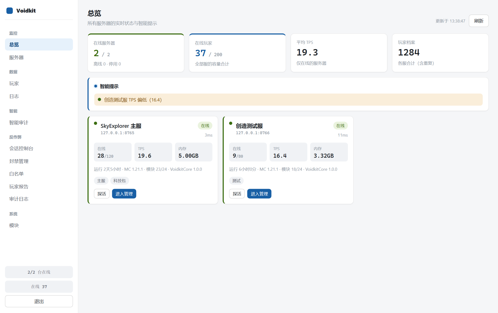
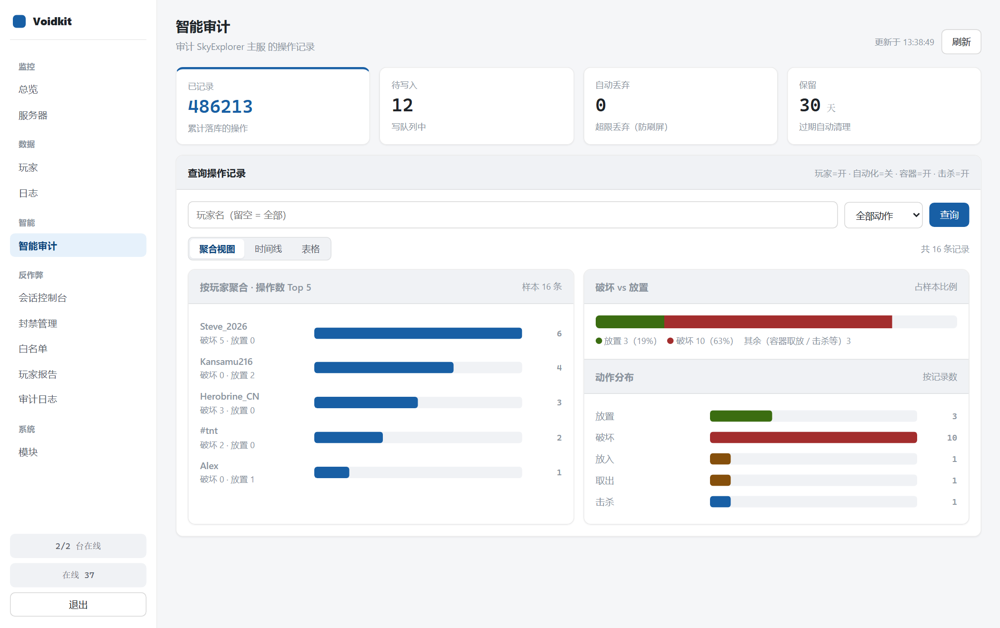
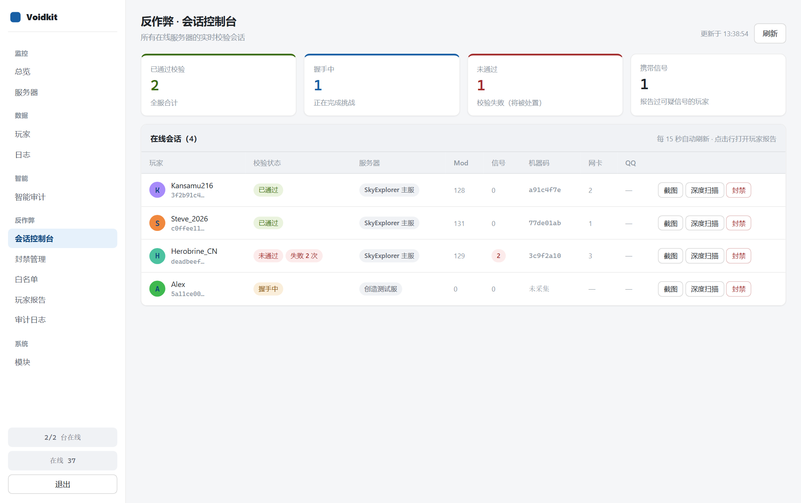
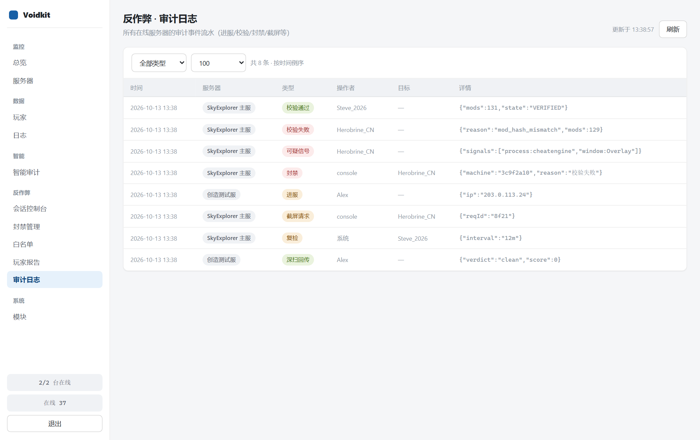
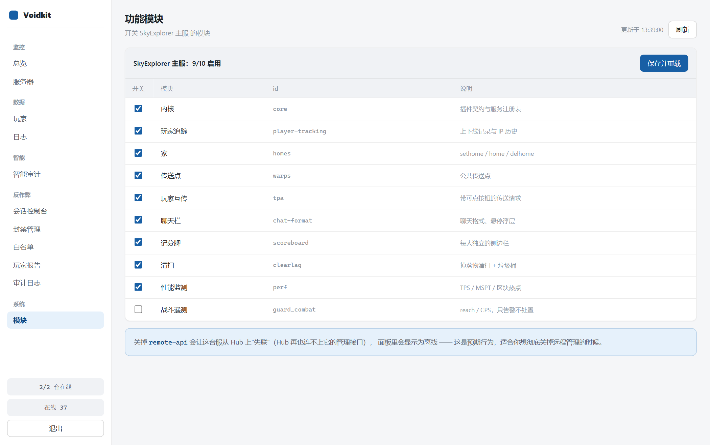

# 管理平台（VoidkitHub）

```
hub/            ← 本仓库内的 Go 程序，与 JVM 无关
```

一个**单二进制 Go 程序**，部署在小内存机器上即可。
它把多台游戏服的 [voidkit_web](./../modules/web.md) API 聚合成**一个后台**，浏览器直接访问。

> 单服也能用：配一台服（本机 `127.0.0.1:8765`）即可当普通面板；
> 多服则配多台，页面自动跨服汇总。

## 架构

```
浏览器 ──▶ VoidkitHub（中心节点）──▶ 各游戏服的 voidkit_web（Agent）
            令牌托管 / 账号 / 聚合        只听 127.0.0.1
```

- 各服的 `apiToken` **只存在 Hub 上**，浏览器只认 Hub 一个凭据。
- Hub 支持**账号密码**（HTTP Basic）+ **机器令牌**两种认证方式。

## 快速开始

```bash
cd hub
go build -o voidkithub .          # 单文件，无运行时依赖
./voidkithub -listen 0.0.0.0:9000 -user admin -pass '改成你自己的'
```

启动参数：

| 参数 | 说明 |
|---|---|
| `-listen` | 监听地址（默认 `0.0.0.0:9000`） |
| `-data` | 数据目录（默认 `./hubdata`，存 `config.json` / `state.json`） |
| `-user` / `-pass` | 面板登录用户名 / 密码（留空则首次运行自动生成并打印） |
| `-token` | 机器访问令牌（给脚本 / 监控用） |
| `-poll` | 轮询各服的间隔（秒） |
| `-timeout` | 单台服务器探测超时（秒） |
| `-show-token` | 只打印当前面板令牌然后退出 |

## 界面

<figure class="vk-shot">
  
  <figcaption>总览 —— 实时状态 + 智能提示（主动指出 TPS 偏低 / 内存偏高 / 离线等问题）</figcaption>
</figure>

<div class="vk-shots">
  <figure class="vk-shot">
    
    <figcaption>智能审计 —— 聚合视图 / 时间线 / 表格三种视图共用一份查询结果</figcaption>
  </figure>
  <figure class="vk-shot">
    
    <figcaption>反作弊会话控制台 —— 一键截图 / 深度扫描 / 封禁，点击行打开玩家报告</figcaption>
  </figure>
</div>

<figure class="vk-shot">
  
  <figcaption>反作弊 · 审计日志 —— 跨服事件流水（进服 / 校验 / 封禁 / 截屏 / 深扫）</figcaption>
</figure>

<figure class="vk-shot">
  
  <figcaption>功能模块 —— 每台服的功能模块一键开关，保存即重载</figcaption>
</figure>

## 页面

| 分组 | 页面 | 说明 |
|---|---|---|
| 机队 | **总览** | 所有服的在线人数、TPS、延迟一屏汇总 |
| | **服务器** | 增删改受管服务器（地址 + apiToken），探测连通性 |
| 玩家 | **玩家查询** | 跨服查玩家（在线 / 历史、IP、当前所在服） |
| | **日志** | 上下线日志汇总 |
| 审计 | **审计** | [Inspector](./../audit/) 的智能审计：按玩家 / 动作聚合条形图 + 操作时间线 |
| 反作弊 | **控制台** | [Guard](./../anticheat/) 会话表（校验状态、一键操作） |
| | **封禁管理** | IP / 机器码 / UUID 封禁与解封 |
| | **白名单** | 哈希锁白名单审核（批准 / 移除） |
| | **判定报告** | 深度扫描与综合判定结论 |
| | **审计流水** | 校验 / 封禁 / 截屏 / 白名单事件的跨服流水 |
| 系统 | **模块** | 各服 `/voidkit features` 一键开关 |

## 开发

- `hub/tools/fake-agent.js` —— 模拟 Agent，便于本地做端到端调试
- `hub/tools/smoke-test.sh` —— 冒烟测试
- 前端在 `hub/web/`（`index.html` + `app.js` + `style.css`），无构建步骤，直接静态托管

## 安全提醒

- 游戏服的 `voidkit_web` 请保持 `bind: 127.0.0.1`，**不要**直接暴露公网。
- Hub 才是唯一对外入口，请务必设置强密码，并在前面加 HTTPS 反向代理。
